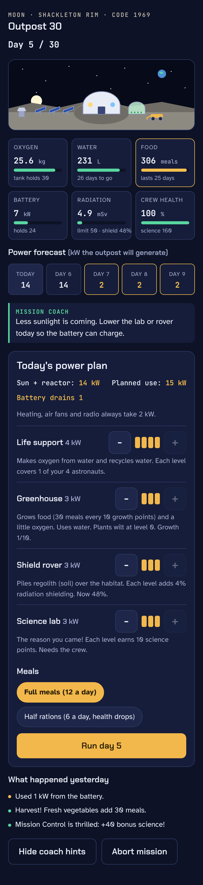

# Outpost 30

**A Junior Astronaut Mission Trainer** · Team Carpathian Cosmos · 2026 NASA Space Apps Challenge

**Play it:** https://andreipopescu-co.github.io/outpost-30/

You command four astronauts on the Moon (Shackleton Rim) or Mars (Jezero Crater). Keep them alive for 30 days and bring home as much science as you can. Every kilowatt you give one system is a kilowatt another system does not get.



## Why we built it

Space-themed learning content tends to fall into two groups: it either hides the engineering trade-offs that decide whether a mission works, or it is too complex to hold a young learner's attention. Outpost 30 keeps one real trade-off at the centre (a limited power budget shared by life support, food, radiation shielding and science) and lets a 9 to 14 year old feel the consequences in a ten-minute game.

## How it plays

Each day has three steps:

1. **Read the forecast.** Sunlight changes. Dust storms (Mars) and dark periods (Moon) are announced a day ahead.
2. **Split the power.** Four systems compete for the same kilowatts:
   - *Life support* makes oxygen from water and recycles water.
   - *Greenhouse* grows food, slowly.
   - *Shield rover* piles regolith over the habitat to block radiation.
   - *Science lab* earns the points the mission exists for.
3. **See what happened.** A plain-language log explains every change.

Events interrupt the plan: solar storms, air leaks, dusty panels, a clogged water filter, a request from Mission Control. Each event card carries an "It really happened" note about a real mission.

The game ends with a **mission debrief**: a mission patch (bronze, silver, gold) or the reason the mission ended, charts of every resource over time, what a real mission planner would say, the facts unlocked, and three discussion questions.

### The two sites teach different lessons

| | Moon, Shackleton Rim | Mars, Jezero Crater |
|---|---|---|
| Sunlight | Strong, with multi-day dark periods | Weaker, dimmed for days by dust storms |
| Radiation | High, no atmosphere | Lower, thin atmosphere helps |
| What goes wrong first | Radiation dose if the shield is built late | Oxygen and battery during a storm |

### For classrooms

- **Mission codes.** A 4-digit code fixes the storms and events. A whole class can play the same mission and compare decisions.
- **Two ranks.** *Cadet* (ages 9+) has extra supplies and a daily hint from the mission coach. *Commander* (ages 12+) has neither.
- Runs in any browser, on a phone, tablet or laptop. No install, no account, no data collected. Works offline once loaded (fonts fall back to system fonts).

## The numbers behind the game

| Quantity | Value in game | Source |
|---|---|---|
| Oxygen per astronaut | 0.84 kg per day | NASA ECLSS reference figures |
| Water recovery | 98% (70% with a clogged filter) | NASA, ISS water recovery milestone, 2023 |
| Oxygen from water | 1 kg water gives 0.89 kg O2 | Electrolysis chemistry, as in the ISS Oxygen Generation Assembly |
| Radiation on Mars surface | 0.67 mSv per day | Curiosity RAD, Hassler et al. 2014 |
| Radiation on Moon surface | 1.37 mSv per day | Chang'e 4 LND, Zhang et al. 2020 |
| Dose limit in game | 50 mSv | Annual occupational limit for radiation workers on Earth, used as a training limit. NASA's career limit is 600 mSv |
| Dust storm | Solar power falls to 20% for days | 2018 global dust storm that ended the Opportunity mission |

### What we simplified, on purpose

- Power is counted in whole "kW" blocks, not real loads.
- The greenhouse is far more productive than any real one. Veggie on the ISS supplements the diet; it does not feed the crew.
- Solar storm doses are tuned so that shielding and sheltering matter within 30 days.
- Regolith shielding reduces cosmic ray dose by up to 60% in the game; real numbers depend on depth and composition.
- A small reactor supplies 2 kW at all times, loosely based on NASA's Fission Surface Power concept.

## Run it locally

Open `index.html` in a browser. That is all.

To change the game, edit `src/game.html` and run `node build.js` to regenerate `index.html`.

```
node test/balance.js   # plays 2,400 scripted missions and prints win rates per strategy
node test/screens.js "$PWD"   # needs Playwright; plays a mission and saves screenshots
```

The balance script checks three strategies on 200 mission codes per site and rank: a careless player (science first, never shelters) always loses, a careful planner always survives, and gold needs better play than the scripted planner.

## Tech

One HTML file. Plain JavaScript, CSS and inline SVG. No framework, no build dependency, no backend, no tracking. The game state is a plain object and the random events come from a seeded generator, which is what makes mission codes reproducible.

## NASA data and resources

- NASA, Environmental Control and Life Support Systems (ECLSS): https://www.nasa.gov/reference/environmental-control-and-life-support-systems-eclss/
- NASA, "NASA Achieves Water Recovery Milestone on International Space Station" (2023): https://www.nasa.gov/missions/station/iss-research/nasa-achieves-water-recovery-milestone-on-international-space-station/
- NASA Curiosity rover, Radiation Assessment Detector (RAD): https://science.nasa.gov/mission/msl-curiosity/
- Hassler, D. M. et al. (2014), "Mars' Surface Radiation Environment Measured with the Mars Science Laboratory's Curiosity Rover", *Science* 343. doi:10.1126/science.1244797
- NASA Opportunity rover and the 2018 dust storm: https://science.nasa.gov/mission/mer-opportunity/
- NASA InSight lander: https://science.nasa.gov/mission/insight/
- NASA, Growing Plants in Space (Veggie): https://www.nasa.gov/exploration-research-and-technology/growing-plants-in-space/
- NASA Fission Surface Power: https://www.nasa.gov/space-technology-mission-directorate/tdm/fission-surface-power/
- NASA Artemis: https://www.nasa.gov/humans-in-space/artemis/
- NASA Human Research Program, Space Radiation: https://www.nasa.gov/hrp/elements/radiation/
- NASA Space Weather Database (DONKI): https://ccmc.gsfc.nasa.gov/tools/DONKI/

## Other references

- Zhang, S. et al. (2020), "First measurements of the radiation dose on the lunar surface", *Science Advances* 6. doi:10.1126/sciadv.aaz1334
- Fonts: Chakra Petch, Atkinson Hyperlegible, JetBrains Mono (SIL Open Font License, via Google Fonts)

## Use of artificial intelligence

The game code, visual design, in-game text, this README and the demo slides were generated with Claude (Anthropic) working as a coding assistant, directed and reviewed by the team. The scene illustration is SVG drawn in code; no AI image, audio or video generators were used. No NASA logos or branding appear in the project.

## What comes next

- Romanian and Spanish translations
- Live space-weather alerts from NASA DONKI as an optional "today's Sun" mission
- A longer 500-day Mars mission with resupply decisions
- A printable teacher guide

## Licence

MIT. See `LICENSE`. Outpost 30 is a student project and is not endorsed by NASA.
